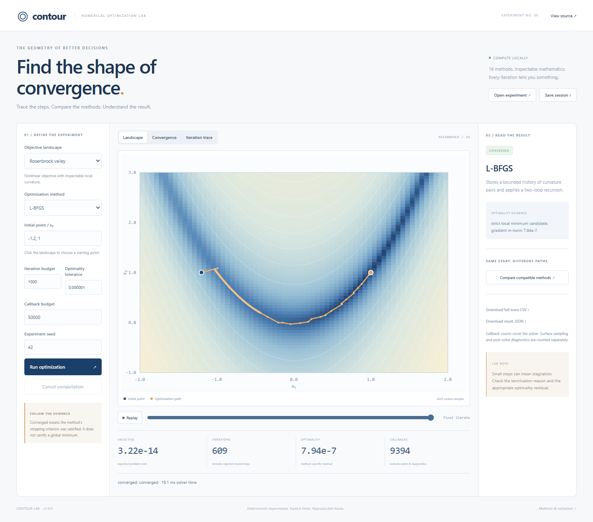

# Numerical Optimization Lab / Contour

A dependency-free JavaScript laboratory for inspectable numerical optimization. Sixteen selectable solver methods share reproducible benchmark cases, explicit termination reasons, bounded computation and an interactive contour workspace.



## Start

Requires Node.js 24 or newer. Run npm ci, then npm start. Open http://127.0.0.1:4178. Computation runs locally in browser workers; no account or API key is required.

## Explore

- Smooth methods: gradient descent, spectral gradient, nonlinear CG, BFGS, L-BFGS, modified Newton, trust-region Newton-CG and Adam.
- Derivative-free methods: Nelder-Mead and pattern search, with geometric stopping criteria.
- Structured methods: box-projected gradient, Levenberg-Marquardt, ISTA, restarted FISTA, LASSO ADMM and inequality active-set QP.
- Library tools: equality QPs, robust losses, local covariance, forward second-order autodiff, finite differences, QR, pivoted LU, Cholesky, eigensystems and matrix-free CG.
- Experiments: seeded regression and curve-fit data, local multistart exploration, parameter studies, variable scaling, contour sampling and full trace/session export.

## Use the library

```js
import { bfgs, rosenbrockProblem, createCase, solveCase } from './src/index.js';
const result = bfgs(rosenbrockProblem(), [-1.2, 1], { gtol: 1e-7 });
console.log(result.status, result.f, result.evaluations);
const constrained = solveCase(createCase('box'), 'projected');
console.log(constrained.optimalityResidual);
```

Run npm test, npm run benchmark, npm run format:check and npm run package:check. Install Chromium using npx playwright install chromium, then run npm run test:browser. Independent references use python validation/scipy_oracles.py after installing validation/requirements.txt; NODE_BINARY can select Node 24 explicitly.

Read [quick start](docs/QUICKSTART.md), [methods](docs/ALGORITHMS.md), [API](docs/API.md), [certificates](docs/CERTIFICATES.md), [validation](docs/VALIDATION.md) and [limits](docs/LIMITATIONS.md). MIT licensed.
